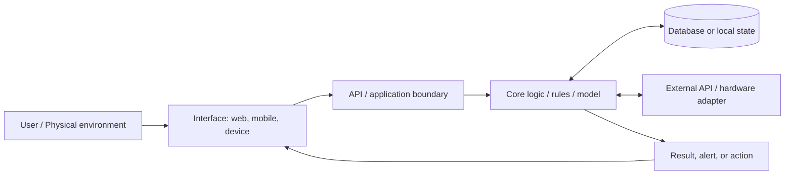

# Architecture

Use this page to explain the actual system, not the system you hope to build later. Replace optional blocks and names as the project evolves.

## System flow

## Components

| Component | Responsibility | Runs where | Owner |
| --- | --- | --- | --- |
| Interface | Collect input and present output |  |  |
| Core logic | Make the important decision or transform data |  |  |
| Data / state | Store only what the project requires |  |  |
| Integrations | External services, sensors, actuators, or models |  |  |
| Evaluation | Verify success criteria and capture evidence |  |  |

## Interfaces and data flow

For every boundary, document the input, output, failure case, and timeout/retry behaviour. Prefer a small explicit contract over assumptions shared in chat.

## Decisions and trade-offs

- Why this stack for this deadline?
- What did we deliberately leave out?
- What dependency is the biggest delivery risk?
- What is mocked in the demo, if anything?

## Run and deploy

- Local setup:
- Start command:
- Test command:
- Deployment target:
- Required environment variables:
- Known failure modes:
