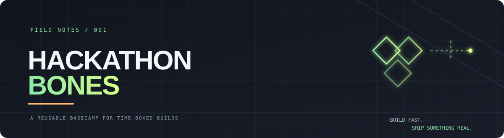

<div align="center">
  

  <p><strong>A reusable starting point for ideas with a deadline.</strong></p>
  <p>Less folder gardening. More working demos.</p>

  <p>
    
    
    
  </p>
</div>

---

## The idea

Every hackathon starts with the same tiny tax: create folders, decide where things go, write the same docs, remember the same setup steps, and then finally build the thing.

**Hackathon Bones is the scaffolding, not the building.** It gives a team a sensible place for code, experiments, hardware, simulation, decisions, and the final demo—without forcing a particular framework or architecture.

> Keep the useful bones. Delete the rest. Ship the project.

## What's in the box?

| Area | What it helps with |
| --- | --- |
| `docs/` | Problem brief, architecture, API contract, pitch notes, and demo script |
| `apps/` | Separate frontend, backend, and worker services when the project needs them |
| `firmware/` | ESP32, Arduino, sensor, and device-side code |
| `simulation/` | Gazebo, Webots, browser simulations, and virtual hardware |
| `ml/` + `data/` | Experiments, datasets, model notes, and reproducibility |
| `packages/shared/` | Types, schemas, constants, and code shared between components |
| `tests/` + `scripts/` | Repeatable checks and small developer utilities |
| `.github/` | Issue forms, pull-request checklist, and Markdown linting |

Nothing here assumes that every project needs every folder. For a tiny web app, you might only keep `apps/web`, `docs`, and `tests`. For a robotics build, `firmware` and `simulation` may be the centre of the repo.

## Quick start

### 1. Make it yours

Use **[Use this template](https://github.com/lextleo/Hackathon-Bones)** once this repository is marked as a GitHub template, or clone it and create a new repository yourself.

```bash
git clone https://github.com/lextleo/Hackathon-Bones.git my-hackathon-project
cd my-hackathon-project
```

If you cloned it, replace the `origin` remote before pushing:

```bash
git remote remove origin
git remote add origin https://github.com/YOUR-USERNAME/YOUR-NEW-REPO.git
```

### 2. Define the target before the tech

Start with [`docs/PROJECT_BRIEF.md`](docs/PROJECT_BRIEF.md). Fill in the user, the problem, the one thing your demo must prove, and what you are **not** building. Then sketch the data flow in [`docs/ARCHITECTURE.md`](docs/ARCHITECTURE.md).

### 3. Trim the skeleton

Delete folders your project will not use. Don't keep a service just because the template has a place for it. A single well-structured app beats five empty services.

### 4. Protect your keys

Copy `.env.example` to `.env`, add local values, and never commit secrets. Keep sample or fake values in documentation and screenshots.

### 5. Build one complete path

Get one user action flowing all the way to a visible result before polishing individual components. Record the setup steps that actually work on a clean machine.

## A hackathon-friendly rhythm

<details>
  <summary><strong>Open the short build loop</strong></summary>

  1. **Scope:** agree on one user, one painful problem, and one measurable outcome.
  2. **Prove:** build the smallest end-to-end path with fake data or a stub if a dependency is not ready.
  3. **Integrate:** connect real services, devices, models, and data only after the path works.
  4. **Freeze:** stop adding features early enough to test the demo from a fresh start.
  5. **Tell the story:** show the problem, the product working, the evidence, and the next step.

</details>

Use [`docs/HACKATHON_RUNBOOK.md`](docs/HACKATHON_RUNBOOK.md) for the fuller checklist and [`docs/DEMO_SCRIPT.md`](docs/DEMO_SCRIPT.md) to plan the final walkthrough.

## Repo map

```text
.
├── apps/                 # Web, API, and worker apps (optional)
├── packages/shared/      # Contracts and utilities shared across components
├── firmware/             # Microcontroller and device-side code (optional)
├── simulation/           # Simulators and virtual environments (optional)
├── ml/                   # Models, experiments, evaluation notes (optional)
├── data/                 # Sample data and documented data flow
├── docs/                 # Brief, architecture, decisions, pitch, demo
├── tests/                # Unit, integration, hardware, and acceptance tests
├── scripts/              # Repeatable setup, build, and demo helpers
├── infra/                # Deployment and infrastructure configuration
├── assets/               # Screenshots, diagrams, and demo media
└── .github/              # Contribution workflow and lightweight checks
```

## The rules that save the most time

- **One source of truth:** put the current setup instructions in this README, not only in chat messages.
- **Keep `main` demoable:** use small branches or focused pull requests when working as a team.
- **Make the demo boring to run:** one documented command path, predictable sample data, and a fallback recording.
- **Separate secrets from config:** `.env.example` is tracked; `.env` is not.
- **Measure claims:** if the pitch says “faster,” “more accurate,” or “low cost,” write down how you measured it.
- **Delete template leftovers:** no empty modules, copied badges, placeholder links, or unused dependencies at submission time.

## Ready-to-submit check

- [ ] A new teammate can run the project using only the README.
- [ ] The core flow works from a fresh start.
- [ ] The problem and target user are clear in one minute.
- [ ] The demo uses realistic data and has a fallback plan.
- [ ] Known limitations and external dependencies are disclosed.
- [ ] No API keys, tokens, private datasets, or personal data are committed.
- [ ] Slides, screenshots, and a short demo clip are in `assets/` or linked from the README.

## Make this a GitHub template

Once the structure is ready, open **Settings → General** for this repository and enable **Template repository**. Then new projects can be created from the template instead of copying files manually. See GitHub's [template repository guide](https://docs.github.com/en/repositories/creating-and-managing-repositories/creating-a-template-repository).

## Build something worth showing

This repo is intentionally unfinished: the next project supplies the actual idea, stack, and implementation. Keep the scaffolding lightweight—and spend the saved time making the demo real.

<div align="center">
  <sub>Hackathon Bones · a personal starter kit by <a href="https://github.com/lextleo">lextleo</a></sub>
</div>
